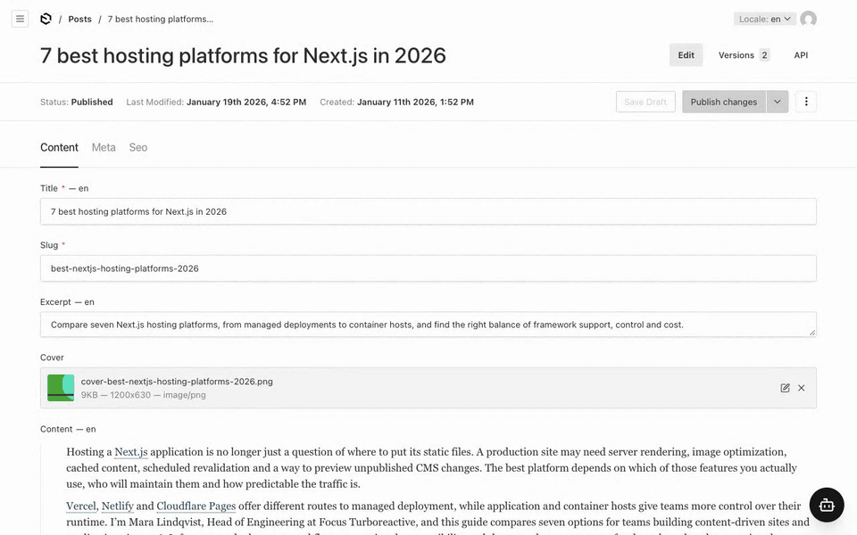
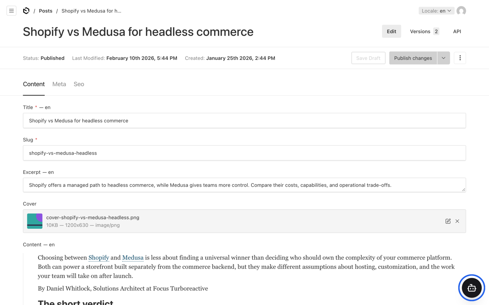
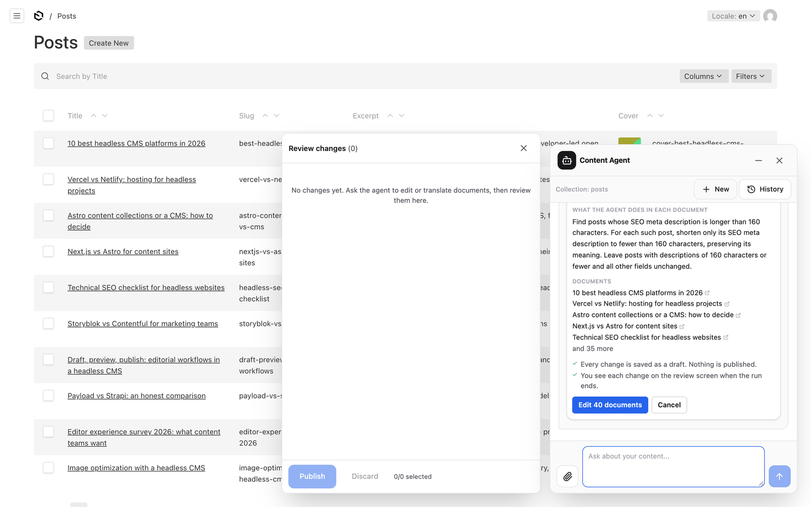
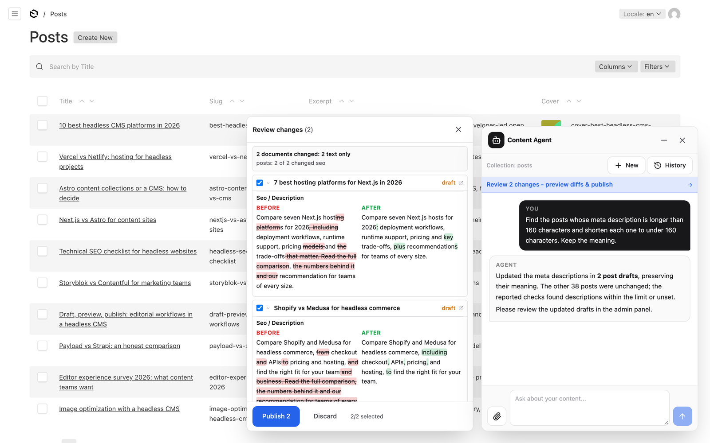

# @focus-reactive/payload-plugin-content-agent

[](https://www.npmjs.com/package/@focus-reactive/payload-plugin-content-agent)
[](LICENSE)
[](https://github.com/focusreactive/payload-plugin-content-agent/actions/workflows/validate.yml)

An AI content agent for Payload CMS 3. The plugin adds a chat panel to the Payload admin. Editors ask the agent in plain language to find, write, edit and translate content. The agent reads your Payload schema, so it works with your own collections, globals, blocks and rich text fields.



What the agent can do:

- Find documents and read their content, including blocks and Lexical rich text.
- Create documents and edit fields, rich text, blocks and arrays.
- Apply one change to many documents at once (bulk edit, find and replace, translation).
- Search the web and import an article from a URL.
- Remember facts about your project between conversations (optional, needs Postgres).

How a change reaches your site:

- The agent saves every change as a draft. Nothing goes live until a person publishes it.
- A person reviews the diff of each change in the chat and publishes it there.
- A collection or global without drafts has no draft. The agent changes a document there only after the person confirms in the chat that the change is live at once. The agent creates no document there. Enable `versions.drafts` on what the agent should edit as drafts.

## Requirements

- Payload 3.61 or newer, with the Lexical rich text editor.
- Node.js 22 or newer.
- [`@payloadcms/plugin-mcp`](https://www.npmjs.com/package/@payloadcms/plugin-mcp). The agent reads and writes content through the MCP tools of this plugin.
- An API key for Anthropic or OpenAI.
- Optional: PostgreSQL for memory and chat history. The `pgvector` extension adds vector search. Without `pgvector`, memory uses full text search.

We test the plugin with Payload 3.91 and 3.93, AI SDK 7, Next.js 16, and Node.js 22 and 24.

## Installation

```bash
npm install @focus-reactive/payload-plugin-content-agent @payloadcms/plugin-mcp ai @ai-sdk/anthropic
```

Install `@ai-sdk/openai` instead of `@ai-sdk/anthropic` if you use OpenAI.

## Minimal configuration

```ts
// payload.config.ts
import { buildConfig } from 'payload'
import { mcpPlugin } from '@payloadcms/plugin-mcp'
import { contentAgentPlugin } from '@focus-reactive/payload-plugin-content-agent'

export default buildConfig({
  // ... your config
  plugins: [
    mcpPlugin({
      collections: {
        posts: { enabled: true },
        pages: { enabled: true },
      },
    }),
    contentAgentPlugin({
      provider: 'anthropic', // reads ANTHROPIC_API_KEY
      // The plugin stops at startup if mcpApiKey is empty. Keep the agent disabled
      // until you have created the MCP API key (see the next section).
      disabled: !process.env.MCP_API_KEY,
      mcpApiKey: process.env.MCP_API_KEY ?? '',
      memoryDatabaseUrl: process.env.DATABASE_URI, // optional
    }),
  ],
})
```

The plugin adds a provider component to the admin and one component to the edit view of each collection and global. Generate the import map after you add or update the plugin:

```bash
npx payload generate:importmap
```

### Create the MCP API key

1. Start Payload and open the admin.
2. Go to **MCP API Keys** and create a key.
3. Give the key access to the collections and globals that the agent may use (see [The MCP API key is the permission boundary](#the-mcp-api-key-is-the-permission-boundary)).
4. Put the key in the `MCP_API_KEY` environment variable and restart Payload.

The chat panel is now available in the admin.

## Usage

### Open the chat

Every page of the admin has a round chat button in the bottom right corner. Click it to open the chat panel. When you open the chat in the edit view of a document, the agent knows which document you mean by "this post" or "this page".



### Ask the agent

Write a request in plain language. For example:

- "Shorten the meta description of this post to under 160 characters."
- "Find the posts whose meta description is longer than 160 characters and shorten each one."
- "Translate this page into Spanish."
- "Replace every link to /old-pricing with /pricing in all posts."

Before a change to many documents, the agent shows what it will do in each document and the list of documents. Click **Edit N documents** to start, or **Cancel**.



### Review and publish

After the agent saves a change, the chat shows **Review N changes**. Click it to open the review panel:

- Each changed document shows its fields before and after the change.
- Select the documents to publish and click **Publish**.
- **Discard** returns each selected document to its state from before the conversation, as a draft.



## The MCP API key is the permission boundary

Read this section before you give the agent to editors.

- **Every chat user acts with the scope of the one MCP API key.** The scope does not depend on the Payload role of the person who chats. If the key can update `pages`, every person who can open the chat can update `pages` through the agent.
- **The agent receives every tool that the MCP server gives for the key.** The plugin does not filter tools by name. This includes the collection and config tools of `@payloadcms/plugin-mcp`.
- **The agent never deletes documents.** The agent does not get a `delete*` tool of the key. A person deletes a document in the admin.
- **The plugin adds safety checks only to `find`, `create` and `update` tools.** These tools always use drafts, and the plugin refuses an update that removes content the agent did not review. Other tools run without these checks.

Recommended scope for the key:

- Give `find`, `create` and `update` for the collections and globals that editors work with.
- Do not give `delete`. The agent refuses these tools, and without them the tool list is shorter.
- Do not enable the collection or config tools of `@payloadcms/plugin-mcp` on a server that the agent uses.
- When you add a new collection, add it to the key. Existing keys do not get new collections automatically.

Only users of the admin auth collection (`config.admin.user`) can use the agent by default. Use the `access` option to change this:

```ts
contentAgentPlugin({
  // ...
  access: ({ req }) => ['users', 'editors'].includes(req.user?.collection),
})
```

## Where your data goes

- **The model provider.** The chat messages, the schema and the content that the agent reads go to the provider that you configure (Anthropic or OpenAI). With vector search, the text of memory entries and of conversation summaries also goes to the embedding model.
- **Web search.** The search words of the agent go to DuckDuckGo. The search needs no API key.
- **Web pages.** The server of your site loads a web page when the agent reads a page or imports an article from a URL. The plugin refuses addresses in private networks, except your own site.
- **Your own site.** The agent calls the MCP endpoint of your site. It loads pictures of your upload collections with the login of the person who chats. Before it saves a new link to your site, the plugin asks your live site whether the linked page exists.
- **Your database.** Chat history, memory and telemetry stay in the Postgres database of `memoryDatabaseUrl`. Without `memoryDatabaseUrl`, the plugin stores none of them. The `telemetry` option controls what a telemetry row keeps.

The plugin sends nothing else and has no analytics.

## Memory

Set `memoryDatabaseUrl` to a Postgres connection string to keep chat history and project memory. This can be the database of Payload or a separate database. The plugin creates its tables in the `content_agent` schema and runs its own migrations at startup. Without `memoryDatabaseUrl`, the agent works without history.

Vector search needs an embedding model. With `provider: 'openai'`, the plugin uses `text-embedding-3-small`. With `provider: 'anthropic'`, pass an embedding model in `embeddingModel`.

### Delete old telemetry

The plugin stores telemetry for every agent run. Call `pruneContentAgentData` from your own scheduled job to delete old rows:

```ts
import { pruneContentAgentData } from '@focus-reactive/payload-plugin-content-agent'

await pruneContentAgentData(process.env.DATABASE_URI!, { olderThanDays: 90 })
```

The function deletes telemetry, background reports and worker rows that are older than `olderThanDays` (default 90). It does not delete conversations or memory.

## Deploy to Vercel

The AI SDK packages load at runtime. Add them to `next.config` so that Vercel includes them in the server functions:

```js
// next.config.mjs
const nextConfig = {
  serverExternalPackages: ['@ai-sdk/anthropic', '@ai-sdk/openai', '@ai-sdk/mcp'],
  outputFileTracingIncludes: {
    '/*': [
      './node_modules/@ai-sdk/anthropic/**/*',
      './node_modules/@ai-sdk/openai/**/*',
      './node_modules/@ai-sdk/mcp/**/*',
    ],
  },
}
```

Set `serverURL` in the Payload config to the public URL of the site. The agent calls the MCP endpoint of the same site through this URL. Without `serverURL`, the agent uses `http://localhost:<PORT>`. On a host where the site does not answer on localhost, such as a serverless deployment, `serverURL` is required (or a full URL in `mcpUrl`).

## Options

| Option | Default | Description |
|---|---|---|
| `mcpApiKey` | required | MCP API key. See [The MCP API key is the permission boundary](#the-mcp-api-key-is-the-permission-boundary). |
| `provider` | - | `'anthropic'` or `'openai'`. Selects default models. You must set `provider` or `model`. |
| `model` | per provider | Main model. A model id (needs `provider`) or an AI SDK `LanguageModel`. |
| `backgroundModel`, `subagentModel` | per provider | Models for memory tasks and sub-agents. |
| `apiKey` | env var | Provider API key. Overrides `ANTHROPIC_API_KEY` or `OPENAI_API_KEY`. |
| `memoryDatabaseUrl` | - | Postgres connection string. Turns on memory and chat history. |
| `reasoningEffort` | `'none'` | How much the main model reasons before it answers: `'none'`, `'low'`, `'medium'` or `'high'`. More is slower. |
| `ltmCurator` | `false` | Lets a background model save preferences to long-term memory by itself after a turn. |
| `turnTokenBudget` | `3000000` | The most tokens one chat request may use, all agents together. The agent then stops and says so. `0` disables. |
| `telemetry` | `'usage'` | What a telemetry row keeps. `'usage'`: steps, tool names, timings, tokens and errors. `'full'` also keeps the input of every tool call and the start of its result. |
| `embeddingModel` | per provider | AI SDK embedding model for vector search. |
| `collections`, `globals` | all | Limit the collections and globals that the agent sees. |
| `access` | admin users | Function that decides who can use the agent. |
| `customInstructions` | - | Text that the plugin adds to the system prompt. |
| `instructions` | off | Editable instructions in the admin. Adds a global. |
| `chatRating` | `false` | Shows a 1-5 star rating under the chat. |
| `mcpOnly` | `false` | The agent uses the MCP tools only, with no Local API behind them. Globals are then out of its reach. |
| `imageInput` | `true` | The agent can look at a picture of an upload collection, for example to write its alt text. Set `false` for a model that takes no picture. |
| `bulkConcurrency` | `5` | Number of documents that a bulk edit processes in parallel. |
| `mcpUrl` | `<routes.api>/mcp` | Path or full URL of the MCP endpoint. |
| `apiRoute` | `'/content-agent/chat'` | Path of the chat endpoint. |
| `disabled` | `false` | Turns the plugin off without removing it from the config. |
| `modules` | - | Extensions built on the module SDK, such as the [Pro modules](#pro-modules). |

[DOCS.md](DOCS.md) describes every option and the internals of the plugin.

## Content tools for other agents

The plugin can also give its checked content tools to an agent outside the admin, for example a coding agent or a desktop assistant that connects to the MCP endpoint of your site. No model runs inside these tools. Wrap the options of the MCP plugin:

```ts
import { mcpPlugin } from '@payloadcms/plugin-mcp'
import { withContentAgent } from '@focus-reactive/payload-plugin-content-agent'

mcpPlugin(
  withContentAgent({
    collections: {
      posts: { enabled: true },
      pages: { enabled: true },
    },
  }),
)
```

The endpoint then has ten more tools next to the default tools of the MCP plugin:

- `getSchemaInfo`, `listDocuments`, `lookupDocuments`, `searchContent`, `checkLinks` and `readDocument` read the content.
- `patchDocument`, `addDocument`, `editDocument` and `replaceText` change it.

Every write of these tools is a draft, is checked before the save, and is refused when it removes or empties content. An API key reads and writes what its `find`, `create` and `update` flags allow. A new key has the ten tools on. On a key that you made before, turn them on in the admin. Give an outside agent a key of its own, not the key in `mcpApiKey`.

The wrap adds one checkbox for each tool to the **MCP API Keys** collection. If your database uses migrations, create and run a Payload migration after you add it.

The second argument selects which default tools of the MCP plugin stay on the endpoint:

```ts
withContentAgent(options, { defaultTools: 'read' })
```

| `defaultTools` | The endpoint has |
|---|---|
| `'all'` (default) | The default tools and the content tools. |
| `'read'` | The default `find` tools and the content tools. |
| `'none'` | Only the content tools. |

With `'read'` and `'none'`, every write through MCP is a checked draft, and a collection or global without drafts takes no write through MCP.

`contentAgentPlugin` is not required for these tools. With it and with memory, a person sees the writes of an outside agent in the chat history, in a conversation named "MCP: <key name>", and reviews them there. See [DOCS.md](DOCS.md#content-tools-on-the-mcp-endpoint).

## Troubleshooting

**Payload stops at startup with `` [Content Agent] `mcpApiKey` must be a non-empty string ``.**
The environment variable of the key is empty. Create the key as in [Create the MCP API key](#create-the-mcp-api-key), or keep `disabled: !process.env.MCP_API_KEY` until the key exists.

**Payload stops at startup with `` [Content Agent] Either `provider` or `model` must be specified ``.**
Set `provider: 'anthropic'` or `provider: 'openai'`, or pass an AI SDK model in `model`.

**The chat button does not show in the admin.**
Run `npx payload generate:importmap` and restart Payload. Run it again after each update of the plugin.

**The log shows `[Content Agent] No MCP tools found for collection(s): ...`.**
Enable each named collection in `mcpPlugin({ collections })` and in the scope of the MCP API key. Then restart Payload.

**The log shows `[Content Agent] MCP server <url> timed out after ...`.**
The agent cannot reach the MCP endpoint of the site. Set `serverURL` in the Payload config to the public URL of the site, or set a full URL in `mcpUrl`. See [Deploy to Vercel](#deploy-to-vercel).

## Pro modules

We also offer paid modules for the plugin in a separate package, `@focus-reactive/payload-plugin-content-agent-pro`. You add them with the `modules` option:

- **Activity log**: records what the agent and people changed, and gives the agent two tools to report on it.
- **External MCP servers**: gives the agent the tools of MCP servers outside Payload.
- **Custom tools**: gives the agent your own AI SDK tools.

To get access, [contact us](https://focusreactive.com/#contacts).

## Contributing

[CONTRIBUTING.md](CONTRIBUTING.md) tells you how to set up the repository, run the checks and the test host, and send a pull request. To report a security problem, follow [SECURITY.md](SECURITY.md). [CHANGELOG.md](CHANGELOG.md) lists the changes of each release.

## License

MIT
